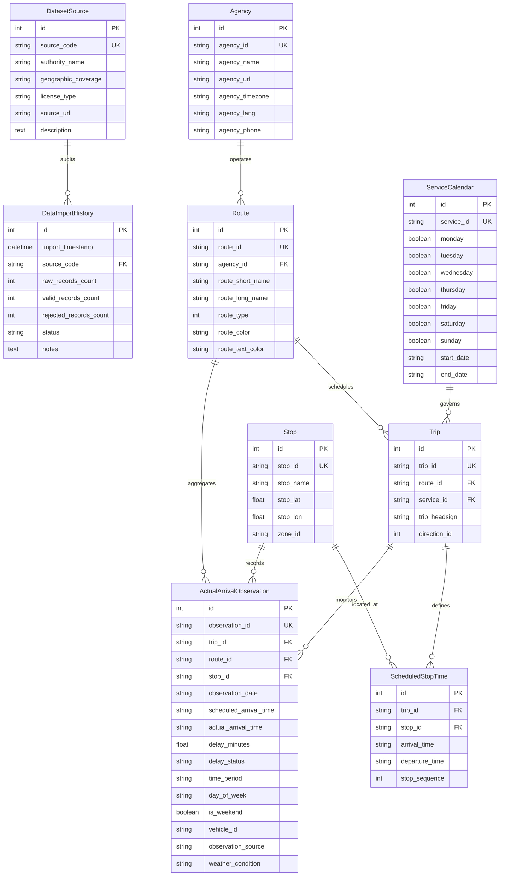

# TransitPulse – Database Design & Schema Specification

**Platform:** TransitPulse – Public Bus Delay Intelligence & Route Reliability Analysis  
**Version:** 1.0.0  
**Effective Date:** November 21, 2026  
**ORM:** SQLAlchemy 2.0+  
**Migrations:** Alembic  
**Dialect Compatibility:** PostgreSQL (Staging / Production), SQLite (Local Development)

---

## 1. Entity-Relationship Architecture

---

## 2. Relational Table Definitions

### 2.1 `dataset_sources`
Tracks data provenance, authority jurisdiction, and open data licensing.
- `source_code`: Unique identifier (e.g., `CUMTA_MTC_2026`).
- `license_type`: E.g., `Government Open Data License (GODL) India`.

### 2.2 `agencies`
Transit operator metadata (Metropolitan Transport Corporation Ltd).

### 2.3 `routes`
Corridor information:
- `route_id`: E.g., `MTC_570`, `MTC_21G`.
- `route_short_name`: Public corridor number (`570`, `21G`, `47A`).
- `route_long_name`: Origin and terminus descriptor.

### 2.4 `stops`
Physical stop coordinates and naming.

### 2.5 `trips` & `scheduled_stop_times`
Timetable definitions with sequence numbers and planned arrival times.
- `uq_trip_stop_seq`: UniqueConstraint preventing duplicate sequences within a single trip.

### 2.6 `actual_arrival_observations`
Empirical observation records with calculated delay minutes and categorizations.
- `uq_obs_trip_stop_date`: UniqueConstraint preventing duplicate arrival logs for the same trip, stop, and calendar date.
- Indexes: `ix_obs_route_date`, `ix_obs_stop_date`, `delay_minutes`, `delay_status`, `time_period`.

### 2.7 `data_import_history`
Audit trail of ETL imports, valid counts, and quarantined anomaly counts.

---

## 3. Database Migration & Alembic Execution

- **Alembic Configuration:** [`backend/alembic.ini`](file:///D:/collegeprojects/TransitPulse/backend/alembic.ini)
- **Initial Migration:** [`backend/alembic/versions/001_initial_transitpulse_schema.py`](file:///D:/collegeprojects/TransitPulse/backend/alembic/versions/001_initial_transitpulse_schema.py)
- **Seeder Script:** [`backend/app/database/seed_db.py`](file:///D:/collegeprojects/TransitPulse/backend/app/database/seed_db.py)
